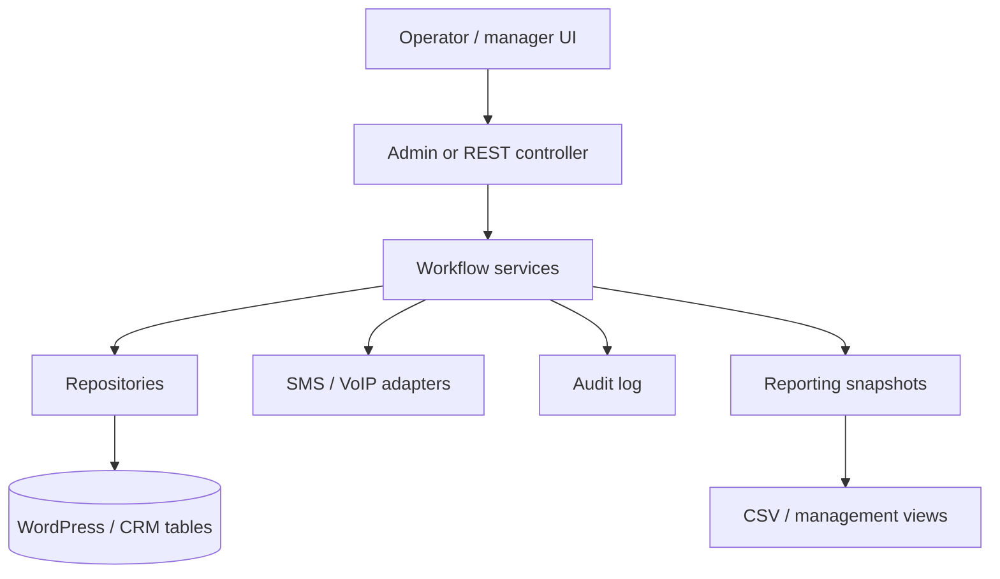

# A2 CRM Operations System

Public-safe architecture case study for a WordPress-based CRM/customer operations system.

This repository documents architecture and representative samples only. It does not contain production customer data, provider credentials, messages, phone numbers, or private workflow logic.

## Latest storefront update

An optional catalog invitation candidate is now documented in the [catalog invitation preview](docs/engineering-notes/catalog-invitation-preview.md). The note covers content access on first arrival, keyboard and motion behavior, browser preview evidence, and remaining release checks. It is not a production release or a measured conversion improvement.

## Reporting update

Financial reporting now separates compensation from cash held by an account owner, assigns each payment to its recorded recipient, and applies selected dates to opening balances, period activity and closing balances. Dated refunds and retry-safe manual expenses are verified with synthetic regression tests. Production figures and business-specific rate settings remain private.

## Education catalogue and entry candidate

A locally tested catalogue refresh adds clearer product/role stories, honest capability states, mobile navigation, FAQ and a working demo/account entry page. Actual school-account authentication remains unfinished and the public site has not been updated by this candidate. See [the candidate and verification scope](docs/engineering-notes/education-catalogue-candidate.md).

## Education readiness review

The Node demonstration is live, while complete product login, business configuration, CRM/advisor acceptance and further A2 visual polish remain open. The implementation roadmap now defines 90 reviewable tasks without claiming new shipped features. See the [readiness review](docs/engineering-notes/education-readiness-review.md).

## Shared Education assistant preview

An optional source candidate now shares text guidance and manager tools with the A2 assistant platform. It reads authorized reports and requires explicit manager confirmation before creating or completing a CRM follow-up. [Candidate evidence and remaining work](docs/engineering-notes/education-shared-agent.md) distinguish these tested changes from the currently published demo; no shared-agent deployment is claimed.

## Education client review preparation

The Education demo now runs as an independent Node application with manager, consultant, student and reviewer views. Visitors use isolated synthetic records, current consent and actual counselor-request/session workflows; guide replies are explicitly simulated. The former WordPress version is retained as a recoverable archive. See the [interactive demo](https://education.amiraliyaghouti.com/demo), [Node demo evidence](docs/engineering-notes/education-node-demo.md), and the [historical WordPress refresh](docs/engineering-notes/education-workspace-refresh.md). Full academic guidance and complete feature-parity acceptance remain open.

The review interface now groups destinations by task, gives each view a short Persian guide, and puts actionable follow-up counts before supporting metrics. Desktop and mobile navigation were checked in both light and dark themes; the client has not yet accepted the experience.

The current client-review build records expected and observed behavior separately for each issue. A reviewer can verify a fix or return it for more work; closure requires verification. Synthetic role, workflow, browser and recovery checks passed, while client acceptance remains pending.

The latest private staging release adds separate operator, sales manager and executive review dashboards, permission-scoped search across customer and sales records, activity filters, and a saved light/dark choice. Synthetic role isolation, direct record navigation, responsive views and backup recovery were checked. Financial figures remain separated by currency, and internally recorded receipts are clearly distinguished from bank confirmation. Client acceptance and production approval are still pending.

## Reviewer Shortcut

This repo demonstrates a WordPress-based CRM and customer operations system through public-safe architecture notes and sanitized samples. It relates to operator inboxes, assignment state, provider callbacks, reporting snapshots, and auditability inside commerce operations. It proves state boundaries, provider abstraction, live-query avoidance, and fail-visible operations. Start with `docs/infrastructure`, `docs/engineering-notes`, and `samples/infrastructure`. This is a showcase repository, not a production package.

## Overview

The system represented here turns WordPress from a content/admin surface into an operational workspace for sales and customer follow-up. The engineering problem is not only CRUD. It is assignment state, customer context, operator workload, provider failure, reporting, and auditability.

## Production Context

- Sales and support work happened across multiple operational channels.
- Operators needed customer history, task state, follow-up context, and role-specific access.
- Managers needed reporting without asking developers for ad hoc exports.
- SMS/VoIP-style integrations had to remain provider-abstracted and replaceable.

## Problem

Disconnected workflows make customer operations slow and hard to supervise. The system needed a controlled CRM layer inside the WordPress/WooCommerce environment without exposing the full admin surface to every operator.

## Operational Constraints

- Keep customer data access role-bound.
- Avoid storing provider secrets in code.
- Keep audit trails for important operational changes.
- Make reporting useful without turning every dashboard request into a heavy live query.
- Keep public documentation anonymized.

## Scaling Challenges

- Operator inboxes become noisy without assignment and state boundaries.
- Customer timelines can become expensive if every view rebuilds live history.
- Provider integrations fail in ways that need retry, visibility, and graceful degradation.
- Reporting must balance freshness with database cost.

## Architecture Decisions

- Service classes own workflow rules.
- Repository classes own database access.
- Provider adapters isolate SMS/VoIP implementation details.
- Audit logging is treated as a core path, not a debug feature.
- Admin UI is scoped by capability and screen context.

## Architecture Map

## Tradeoffs

- Keeping CRM inside WordPress reduces integration friction but requires strict capability design.
- Snapshot reporting reduces query pressure but introduces freshness decisions.
- Provider abstraction adds code structure but prevents the system from being locked to one vendor.
- Detailed audit logs increase storage but make operational review possible.

## Failure Prevention

- Capability checks before every write.
- Nonce checks for admin actions.
- Provider adapters fail closed and return structured status.
- Audit records store what changed without exposing private message content in public samples.
- Reporting queries are separated from high-frequency operator interactions.
- Mobile floating controls use measured bottom-surface offsets instead of device-specific hard-coded positions.
- Security refactors begin from a private, byte-verifiable deployed-source baseline while environment configuration remains outside version control.
- In-person store workflows keep customer edits, financial order records, return/exchange adjustments, warehouse context, and loyalty feedback as explicit CRM operations.
- Structured in-person order fields can be extended by operators without turning reporting-critical values into unbounded free text.

## Performance Strategy

- Use repository methods for bounded reads.
- Avoid loading full customer history unless the view requires it.
- Keep reporting data exportable without forcing live dashboard rebuilds.
- Separate provider calls from UI rendering where possible.

## Operational Learnings

- A CRM is only useful if operators trust its state.
- Internal tools need less visual decoration and more predictability.
- Auditability matters most during exceptional customer or order cases.
- Provider integrations should be treated as unreliable network boundaries.

## Future Improvements

- Add sanitized screenshots of operator inbox states.
- Add a public test fixture for assignment and capability rules.
- Add a changelog for public architecture revisions.

## Code Samples

- assignment service;
- repository layer;
- provider adapter;
- audit logger;
- admin page boundary.

## Engineering Notes

- [Operator inbox state boundaries](docs/engineering-notes/operator-inbox-state-boundaries.md)
- [Provider abstraction for SMS and VoIP](docs/engineering-notes/provider-abstraction-for-sms-and-voip.md)
- [Reporting without live query pressure](docs/engineering-notes/reporting-without-live-query-pressure.md)
- [Mobile floating control resilience](docs/engineering-notes/mobile-floating-control-resilience.md)

## Infrastructure Notes

- [Request lifecycle](docs/infrastructure/request-lifecycle.md)
- [Observability and instrumentation](docs/infrastructure/observability-and-instrumentation.md)
- [Failure mode matrix](docs/infrastructure/failure-mode-matrix.md)
- [Infrastructure samples](samples/infrastructure)

## Quality Signal

- [Quality signal notes](docs/quality-signal.md)
- [Sample PHP syntax workflow](.github/workflows/sample-php-lint.yml)
- [Samples directory](samples)

## Related Technical Writing

- [CRM Operator Inboxes Need State Boundaries](https://github.com/shiny-a2/shiny-a2/blob/main/docs/technical-writing/articles/crm-operator-inboxes-need-state-boundaries.md)

## Security & Privacy Notes

Production customer data, phone numbers, messages, provider credentials, internal workflows, and private logs are excluded.

## Tech Stack

PHP, WordPress, WooCommerce, MySQL, REST/admin AJAX, JavaScript, SMS/VoIP provider abstraction.

## Related Portfolio

- Portfolio: https://amiraliyaghouti.com
- Projects: https://amiraliyaghouti.com/projects.html
- Case studies: https://amiraliyaghouti.com/case-studies.html
- GitHub profile: https://github.com/shiny-a2

[Education business sign-in candidate](docs/engineering-notes/education-business-signin-candidate.md) adds locally tested business and branch access over the existing shared identity, with the public demo kept separate. Production account activation and editable business settings remain pending.

[Education business settings candidate](docs/engineering-notes/education-business-settings-candidate.md) adds confirmed business profile editing, scoped history and retry/conflict protection using a shared Core contract. Locally verified; deployment and full-product acceptance remain pending.
